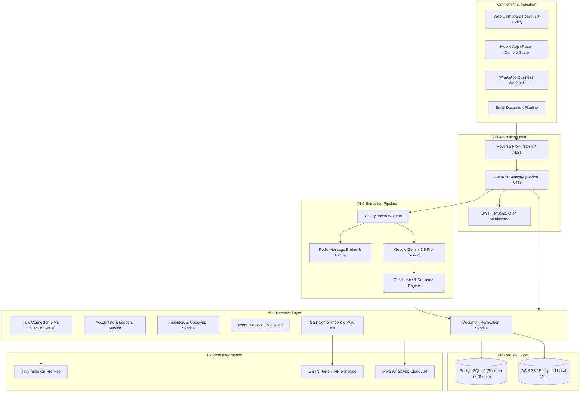

# Daynisc Pro — AI-Powered Enterprise ERP & Tally Automation Platform

[](https://python.org)
[](https://fastapi.tiangolo.com)
[](https://react.dev)
[](https://www.typescriptlang.org)
[](https://vitejs.dev)
[](https://www.postgresql.org)
[](https://www.docker.com)
[](https://ai.google.dev)
[](https://tallysolutions.com)
[](https://www.electronjs.org)

---

## Executive Overview

**Daynisc Pro** is an autonomous, AI-first Enterprise Resource Planning (ERP) and business automation ecosystem tailored for Indian manufacturers, masterbatch and polymer plants, distributors, traders, and logistics operators.

The platform eliminates 95% of manual business data entry through a zero-touch pipeline:
1. **Multimodal Ingestion:** Invoices, purchase bills, transport Lorry Receipts (LR), and bank statements are ingested via Web Upload, Camera Scan, WhatsApp Bot, or Email forwarder.
2. **Gemini Vision OCR & Deep Learning Extraction:** Multilingual document understanding (English, Hindi, Gujarati) with line-item extraction, GSTIN validation, and HSN categorization.
3. **Automated Verification & Fraud Guard:** Confidence scoring, duplicate detection, and automated discrepancy flagging.
4. **Instant Bi-Directional Tally Sync:** Verified entries are automatically converted to TallyPrime XML envelopes and pushed directly to TallyPrime via its native HTTP XML server on port 9000.

---

## System Architecture



---

## Verified Project Directory Structure

```text
Daynisc_Pro/
|-- backend/                           # Python FastAPI Core Application
|   |-- main.py                        # FastAPI application entry point & route registration
|   |-- demo_server.py                 # Standalone development API server with mock fallbacks
|   |-- ai_extractor.py                # Gemini 1.5 Pro Vision OCR extraction engine
|   |-- documents_router.py            # Document ingestion, OCR status & approvals
|   |-- erp_sync_router.py             # TallyPrime XML generation, HTTP push & retry queue
|   |-- accounting_router.py           # Vouchers, ledger impacts, aging, and bank statements
|   |-- masters_router.py              # Customers, vendors, chart of accounts & warehouses
|   |-- sales_router.py                # Quotations, sales orders, challans & tracking
|   |-- ai_assistant_router.py         # Financial analytics, cash-flow forecast & NLP copilot
|   |-- requirements.txt               # Backend Python dependencies
|   |-- Dockerfile                     # Multi-stage container definition
|   `-- shared/                        # Shared config, multi-tenant DB session & security
|
|-- web_dashboard/                     # Production React 18 Web ERP Dashboard & Desktop
|   |-- index.html                     # Web entry point
|   |-- vite.config.ts                 # Vite bundler configuration & proxy routes
|   |-- package.json                   # React, TanStack Query, Lucide, Recharts & Electron
|   |-- App.tsx                        # Master routing, providers & error boundary
|   |-- main.tsx                       # React DOM mount point
|   |-- main.cjs                       # Electron desktop runner
|   |-- preload.cjs                    # Electron secure bridge
|   |-- components/                    # Reusable enterprise UI components
|   |   |-- Icons.tsx                  # Feather/Lucide SVG stroke-based central icon library
|   |   `-- layout/
|   |       `-- DashboardLayout.tsx    # Sidebar shell, Tally status indicator & quick scanner
|   |-- pages/                         # Core ERP application modules
|   |   |-- DashboardPage.tsx          # Real-time executive KPIs, alerts & activity feed
|   |   |-- AIVerificationPage.tsx     # Split-screen OCR viewer, correction & 1-click approve
|   |   |-- ERPSyncPage.tsx            # TallyPrime connection diagnostic, queue & XML audit
|   |   |-- AccountingPage.tsx         # Vouchers, multi-currency ledger, aging & bank recon
|   |   |-- MastersPage.tsx            # Dual master records (Customers, Vendors, Ledgers)
|   |   |-- SalesPage.tsx              # Orders, quotations, challans, GPS & payments
|   |   |-- InventoryPage.tsx          # Multi-warehouse stock valuation & reorder triggers
|   |   |-- ProductionPage.tsx         # Multi-level BOM editor, shift logs & QC inspection
|   |   |-- GSTPage.tsx                # GSTR-1, GSTR-3B, GSTR-2B ITC recon & e-Way Bill
|   |   |-- BankingPage.tsx            # Bank statement upload, auto-matching & cheque print
|   |   |-- CRMPage.tsx                # Opportunity stages, predictive conversion & follow-ups
|   |   |-- WorkflowEnginePage.tsx     # Visual approval matrices & delegation hierarchies
|   |   |-- AutomationBuilderPage.tsx  # Event-driven rule builder & trigger actions
|   |   |-- SuperAdminPage.tsx         # Multi-tenant provisioning & schema orchestrator
|   |   `-- SettingsPage.tsx           # Tally HTTP, Gemini API keys, roles & company metadata
|   `-- store/                         # State management & HTTP client
|       |-- apiClient.ts               # Axios client with auto-refresh JWT middleware
|       |-- authStore.ts               # Zustand authentication store
|       `-- theme.ts                   # Enterprise design tokens, colors & formatting
|
|-- mobile/                            # Flutter Mobile Client (iOS & Android)
|   |-- lib/
|   |   |-- main.dart                  # App bootstrap & routing
|   |   |-- scan_screen.dart           # Camera OCR capture with automatic edge detection
|   |   `-- production_screen.dart     # Factory floor shift logs & batch updates
|   `-- pubspec.yaml                   # Flutter dependencies & assets
|
|-- database/                          # Relational Storage & Multi-Tenant Migrations
|   `-- schema.sql                     # PostgreSQL multi-tenant schema with isolation triggers
|
|-- deployment/                        # Infrastructure as Code
|   |-- k8s-manifests.yaml             # Kubernetes manifests (EKS / GKE production deployment)
|   `-- ci-cd.yml                      # GitHub Actions automated lint, build & test pipeline
|
|-- docker-compose.yml                 # Full-stack local development orchestrator
|-- start_all.bat                      # Windows one-click local development launcher
|-- start_backend.ps1                  # PowerShell backend launcher with port diagnostics
|-- blueprint.html                     # Full interactive architecture blueprint & system specs
|-- TALLY_INTEGRATION_GUIDE.md         # Comprehensive TallyPrime XML HTTP manual
`-- .env.example                       # Environment variable templates
```

---

## Core Feature Modules

### 1. Document Understanding & AI Verification
* **Multi-Format Ingestion:** Supports PDF, JPEG, PNG, TIFF, and HEIC up to 15MB.
* **Multilingual OCR:** Extracts unstructured documents in English, Hindi, and Gujarati using Google Gemini 1.5 Pro Vision.
* **Extraction Schema:** Automatically maps Party GSTIN, Invoice Number, Invoice Date, PO Reference, Line Items (Item Name, HSN Code, Quantity, Unit, Rate, Discount, CGST, SGST, IGST, Total Amount), Vehicle Number, and Transport LR Number.
* **Verification Console:** Side-by-side interactive document viewer with high-contrast field highlighting, real-time corrections, and 1-click batch approval.
* **Self-Learning Alias Mapping:** If a vendor invoice says "RIL Poly Grade A", but Tally's ledger is "Reliance Industries Ltd - Poly A", the engine remembers the human correction for all future entries.

### 2. TallyPrime XML HTTP Bi-Directional Integration
* **Native HTTP Interface:** Connects directly to TallyPrime's built-in HTTP server on port 9000 without requiring third-party DLLs or intrusive plugins.
* **Voucher Generation:** Generates valid Tally XML envelopes (`ENVELOPE/BODY/DATA/TALLYMESSAGE/VOUCHER`) for Sales, Purchase, Payment, Receipt, Contra, and Stock Journal entries.
* **Master Synchronization:** Queries Tally's active company list and verifies the existence of ledgers before pushing vouchers.
* **Fault-Tolerant Offline Queue:** Vouchers created while Tally is offline are held in a pending queue with automated retry intervals and detailed XML error logs.

### 3. Industrial Accounting & Financial Ledgers
* **Chart of Accounts:** Hierarchical classification following Indian Accounting Standards.
* **Accounts Receivable & Payable:** Real-time aging analysis (0-30, 31-60, 61-90, 90+ days) with automated WhatsApp and SMS collection reminders.
* **Bank Reconciliation:** Upload MT940, CSV, or Excel bank statements for automated line-by-line reconciliation with ERP vouchers.
* **Audit Trail:** Immutable ledger logs recording user ID, timestamp, and before/after values for every financial entry.

### 4. Sales, Distribution & Logistics
* **Quotation-to-Cash:** Track lifecycle from Quotation -> Sales Order -> Delivery Challan -> Tax Invoice -> Payment Collection.
* **Dispatch & Transport Management:** Vehicle assignment, Lorry Receipt (LR) tracking, and GPS milestone tracing.
* **Credit Limit Enforcement:** Real-time credit utilization checks with admin override authorization.

### 5. Production & Multi-Warehouse Inventory
* **Multi-Level Bill of Materials (BOM):** Define raw material consumption, scrap allowances, and overhead allocations.
* **Production Orders:** Stage-by-stage job cards (Raw Material Issue, Processing, Quality Inspection, Finished Goods Receipt).
* **Multi-Warehouse Stock:** Live Godown valuation (FIFO / Weighted Average), transfer challans, and reorder point alerts.

### 6. Indian GST Compliance & Statutory Reports
* **GSTR-1 & GSTR-3B:** Portal-ready JSON export with automated tax-rate grouping (0%, 5%, 12%, 18%, 28%).
* **GSTR-2B ITC Matching:** Automatic reconciliation between GSTR-2B downloads and purchase registers to catch missing input tax credit.
* **e-Invoicing & e-Way Bill:** Direct API integration with Invoice Registration Portals (IRP) for real-time IRN and QR code generation.

---

## Installation & Quick Start

### System Prerequisites
* **Docker Engine** 24.0+ & **Docker Compose** 2.20+
* **Node.js** 18.18+ & **npm** 9.0+
* **Python** 3.11+
* **TallyPrime** Release 2.0+ (running locally or on LAN with HTTP enabled)

### Option A: Complete Docker Compose Stack

1. **Clone the repository:**
   ```bash
   git clone https://github.com/your-org/daynisc-pro.git
   cd daynisc-pro
   ```

2. **Configure environment variables:**
   ```bash
   cp .env.example .env
   # Edit .env to supply your GEMINI_API_KEY and DATABASE_URL
   ```

3. **Launch all services:**
   ```bash
   docker-compose up -d --build
   ```

4. **Service Access Points:**
   | Component | URL | Default Credentials |
   | :--- | :--- | :--- |
   | **Web Dashboard** | `http://localhost:3000` | `admin@daynisc.com` / `admin123` |
   | **FastAPI Swagger Docs** | `http://localhost:8000/docs` | Public |
   | **FastAPI ReDoc** | `http://localhost:8000/redoc` | Public |
   | **Flower Celery Monitor** | `http://localhost:5555` | Configurable |
   | **PostgreSQL** | `localhost:5432` | `postgres` / `postgres` |

---

### Option B: Local Windows Development Setup

1. **Start the FastAPI Backend:**
   Open PowerShell in the project root:
   ```powershell
   ./start_backend.ps1
   ```
   *The script automatically checks port 8000, installs Python dependencies from `backend/requirements.txt`, and launches Uvicorn.*

2. **Start the Web Dashboard:**
   Open a separate terminal window:
   ```bash
   cd web_dashboard
   npm install
   npm run dev
   ```
   *The Vite development server will start at `http://localhost:3000` with automated API proxying to `http://localhost:8000`.*

3. **Launch Full Stack via Batch Script:**
   Double-click `start_all.bat` to launch both Backend and Web Dashboard in parallel.

4. **Build Windows Desktop Executable (NSIS Installer):**
   ```bash
   cd web_dashboard
   npm run dist
   ```
   *The standalone Windows installer will be generated in `web_dashboard/release/Daynisc ERP Setup 1.0.0.exe`.*

---

## TallyPrime Integration Guide

To enable automated synchronization between Daynisc Pro and TallyPrime:

### 1. Enable TallyPrime HTTP Server
1. Launch **TallyPrime** and load your target company.
2. Press **F12** (Configure) -> Select **Advanced Configuration**.
3. Under the **Client/Server Configuration** section:
   * Set **TallyPrime acts as** to `Both` (or `Server`).
   * Set **Enable ODBC Server** to `Yes`.
   * Set **Port** to `9000`.
4. Press **Ctrl + A** to save changes.
5. Restart TallyPrime to initialize the HTTP server.

### 2. Configure Daynisc Pro
1. Navigate to **Web Dashboard -> Tally Prime Sync** (or **Settings -> ERP Integration**).
2. Set **Tally URL** to `http://localhost:9000` (or the LAN IP if Tally runs on another machine).
3. Set **Company Name** to the exact company name open in TallyPrime.
4. Click **Test Connection**. The dashboard will query Tally's active company and display a green connection badge.

### 3. Sample TallyPrime XML Envelope (Purchase Voucher)
Daynisc Pro automatically formats vouchers into Tally-compliant XML:

```xml
<ENVELOPE>
  <HEADER>
    <TALLYREQUEST>Import Data</TALLYREQUEST>
  </HEADER>
  <BODY>
    <IMPORTDATA>
      <REQUESTDESC>
        <REPORTNAME>Vouchers</REPORTNAME>
        <STATICVARIABLES>
          <SVCURRENTCOMPANY>ABC Polymers Ltd</SVCURRENTCOMPANY>
        </STATICVARIABLES>
      </REQUESTDESC>
      <REQUESTDATA>
        <TALLYMESSAGE xmlns:UDF="TallyUDF">
          <VOUCHER VCHTYPE="Purchase" ACTION="Create" OBJVIEW="Accounting Voucher View">
            <DATE>20260628</DATE>
            <VOUCHERTYPENAME>Purchase</VOUCHERTYPENAME>
            <VOUCHERNUMBER>PUR-3001</VOUCHERNUMBER>
            <REFERENCE>INV-2901</REFERENCE>
            <PARTYLEDGERNAME>Reliance Polymers Ltd</PARTYLEDGERNAME>
            <PERSISTEDVIEW>Accounting Voucher View</PERSISTEDVIEW>
            <ALLLEDGERENTRIES.LIST>
              <LEDGERNAME>Reliance Polymers Ltd</LEDGERNAME>
              <ISDEEMEDPOSITIVE>No</ISDEEMEDPOSITIVE>
              <AMOUNT>88118.00</AMOUNT>
            </ALLLEDGERENTRIES.LIST>
            <ALLLEDGERENTRIES.LIST>
              <LEDGERNAME>Purchase Account - Raw Material</LEDGERNAME>
              <ISDEEMEDPOSITIVE>Yes</ISDEEMEDPOSITIVE>
              <AMOUNT>-72000.00</AMOUNT>
            </ALLLEDGERENTRIES.LIST>
            <ALLLEDGERENTRIES.LIST>
              <LEDGERNAME>Input CGST 9%</LEDGERNAME>
              <ISDEEMEDPOSITIVE>Yes</ISDEEMEDPOSITIVE>
              <AMOUNT>-6480.00</AMOUNT>
            </ALLLEDGERENTRIES.LIST>
            <ALLLEDGERENTRIES.LIST>
              <LEDGERNAME>Input SGST 9%</LEDGERNAME>
              <ISDEEMEDPOSITIVE>Yes</ISDEEMEDPOSITIVE>
              <AMOUNT>-6480.00</AMOUNT>
            </ALLLEDGERENTRIES.LIST>
            <ALLLEDGERENTRIES.LIST>
              <LEDGERNAME>Freight Inward</LEDGERNAME>
              <ISDEEMEDPOSITIVE>Yes</ISDEEMEDPOSITIVE>
              <AMOUNT>-3158.00</AMOUNT>
            </ALLLEDGERENTRIES.LIST>
          </VOUCHER>
        </TALLYMESSAGE>
      </REQUESTDATA>
    </IMPORTDATA>
  </BODY>
</ENVELOPE>
```

---

## REST API Reference

All backend endpoints are documented interactively via OpenAPI at `/docs`.

### Authentication
| Method | Endpoint | Description |
| :--- | :--- | :--- |
| `POST` | `/api/v1/auth/otp/request` | Request 6-digit SMS OTP via MSG91 |
| `POST` | `/api/v1/auth/otp/verify` | Verify OTP and issue JWT access/refresh token pair |
| `POST` | `/api/v1/auth/token/refresh` | Exchange refresh token for a new 15-minute access token |

### Document Extraction & AI
| Method | Endpoint | Description |
| :--- | :--- | :--- |
| `POST` | `/api/v1/documents/upload` | Multipart file upload (PDF/image) with async OCR queueing |
| `GET` | `/api/v1/documents/{id}/status` | Check Gemini OCR extraction status and confidence score |
| `POST` | `/api/v1/documents/{id}/approve` | Approve extracted document and create accounting voucher |
| `POST` | `/api/v1/documents/{id}/reject` | Reject extraction with auditor reason code |

### Accounting & Vouchers
| Method | Endpoint | Description |
| :--- | :--- | :--- |
| `GET` | `/api/v1/accounting/vouchers` | List vouchers with filter by type, date, and sync status |
| `POST` | `/api/v1/accounting/vouchers` | Create new double-entry voucher |
| `GET` | `/api/v1/accounting/aging` | Get accounts receivable and payable aging buckets |
| `POST` | `/api/v1/accounting/bank-recon` | Match imported bank statement against ERP entries |

### Tally Integration
| Method | Endpoint | Description |
| :--- | :--- | :--- |
| `GET` | `/api/v1/erp/connection/test/tally` | Test HTTP connectivity to Tally on port 9000 |
| `POST` | `/api/v1/erp/sync/voucher/{id}` | Push a specific voucher XML to TallyPrime |
| `POST` | `/api/v1/erp/sync/batch` | Bulk sync all approved pending vouchers to Tally |
| `GET` | `/api/v1/erp/sync/queue` | View status of all queued, failed, and synced entries |

---

## Enterprise Security & Tenancy

* **Multi-Tenant Database Isolation:** PostgreSQL schema-per-tenant architecture guarantees complete separation of financial data between customer organizations.
* **Role-Based Access Control (RBAC):** Seven pre-configured roles:
  1. `Super Admin` (System provisioning, tenant management)
  2. `Company Owner` (Full financial visibility, approval overrides)
  3. `Finance Head / Controller` (Voucher posting, bank recon, GST filing)
  4. `Accountant` (Data verification, draft entries)
  5. `Factory / Production Manager` (BOM maintenance, job cards)
  6. `Warehouse / Dispatch Manager` (Stock updates, challans, LR upload)
  7. `Auditor` (Read-only access with immutable audit trail export)
* **Document Vault Encryption:** Uploaded business documents are encrypted at rest with AES-256 and signed via time-limited URLs.
* **Transport Security:** Strict TLS 1.3 encryption enforced across all external web, mobile, and API traffic.

---

## Development & Testing

### Running Tests
```bash
# Backend unit & integration tests
pytest backend/tests/ -v

# Frontend TypeScript compilation & bundle validation
cd web_dashboard
npm run build
```

---

## Support & Enterprise Contact

Designed and engineered for Indian SMEs, factories, and trade ecosystems.
* **Language Support:** English, Hindi (हिन्दी), Gujarati (ગુજરાતી)
* **Target Industries:** Masterbatch & Polymer Manufacturing, Chemical Processing, Engineering, Wholesale Distribution, Transport & Fleet Logistics.
* **License:** Proprietary Enterprise License. All rights reserved.
