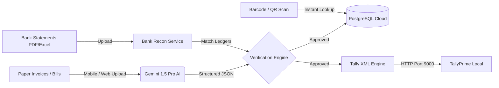

# Daynisc Pro — Complete Tech Stack & Architectural Master Document

> **Platform:** Daynisc Pro (Enterprise AI-Powered ERP & Tally Automation)  
> **Repository:** [https://github.com/dbdigitallabs/Daynisc_Pro](https://github.com/dbdigitallabs/Daynisc_Pro)  
> **Live Web Application:** [https://webdashboard-dun.vercel.app](https://webdashboard-dun.vercel.app)  
> **Database Provider:** Supabase Cloud PostgreSQL (AWS Mumbai `ap-south-1`)  

---

## Table of Contents
1. [Executive Overview & Problem Statement](#1-executive-overview--problem-statement)
2. [Why We Chose Each Programming Language](#2-why-we-chose-each-programming-language)
3. [Comprehensive Libraries & Frameworks Breakdown](#3-comprehensive-libraries--frameworks-breakdown)
   - [3.1 Backend & AI Pipeline (Python)](#31-backend--ai-pipeline-python)
   - [3.2 Web Dashboard & Desktop (React + TypeScript + Vite)](#32-web-dashboard--desktop-react--typescript--vite)
   - [3.3 Mobile Application (Flutter + Dart)](#33-mobile-application-flutter--dart)
   - [3.4 Database & Persistence Layer](#34-database--persistence-layer)
4. [Core Architectural Modules](#4-core-architectural-modules)
   - [AI Document Ingestion & Vision OCR](#ai-document-ingestion--vision-ocr)
   - [TallyPrime XML Bi-directional Sync Engine](#tallyprime-xml-bi-directional-sync-engine)
   - [Real-Time Barcode & QR Code Inventory Engine](#real-time-barcode--qr-code-inventory-engine)
   - [AI Bank Statement Import & Reconciliation Engine](#ai-bank-statement-import--reconciliation-engine)
5. [Cloud Hosting, DevOps & Security Architecture](#5-cloud-hosting-devops--security-architecture)
6. [Summary of Key Developer Commands](#6-summary-of-key-developer-commands)

---

## 1. Executive Overview & Problem Statement

### The Problem
Indian manufacturing plants, polymer/masterbatch enterprises, distributors, and trading firms lose hundreds of manual hours every month to:
1. **Manual Bill & Invoice Entry:** Operators re-typing physical supplier invoices and transport bills into TallyPrime or ERPs, causing typing mistakes, wrong tax rates, and duplicate entries.
2. **Disconnected Warehouses & Inventory:** Warehouse staff checking physical stock manually instead of scanning barcodes with mobile devices.
3. **Tedious Bank Reconciliation:** Accounts teams spending days cross-referencing multi-page bank PDF/Excel statements against accounting ledgers line by line.
4. **Tally Synchronization Bottlenecks:** Traditional software requiring manual export/import of Excel files into Tally, leading to sync conflicts and financial discrepancies.

### The Daynisc Pro Solution
**Daynisc Pro** is an autonomous, AI-first ERP platform that bridges modern cloud technology with on-premise Indian business realities:
* **Zero-Touch Ingestion:** Takes invoices via mobile camera, scanner, web drag-and-drop, WhatsApp, or email.
* **Multilingual AI Vision:** Reads English, Hindi, and Gujarati documents, extracts line items, validates GSTINs, and maps HSN codes.
* **Instant TallyPrime Integration:** Pushes verified vouchers directly to local TallyPrime (Port 9000) using native XML envelopes without manual import steps.
* **Automated Bank Reconciliation:** Imports bank statements (PDF/Excel), analyzes transaction narrations, creates matching vouchers, and performs reconciliation automatically.

---

## 2. Why We Chose Each Programming Language

| Language | Layer | Why We Chose It |
| :--- | :--- | :--- |
| **Python 3.11+** | Backend, AI, Data Pipelines, Tally Connector | **The gold standard for AI, ML, and Data Engineering.** Python provides official SDKs for Google Gemini, high-speed asynchronous web handling via ASGI, powerful libraries for parsing PDFs and Excel files (`pdfplumber`, `openpyxl`), and simple XML string manipulation for Tally integration. |
| **TypeScript 5.x** | Frontend Web Dashboard & Desktop App | **Strict Type Safety across complex ERP models.** ERPs handle dozens of interdependent financial fields (GST rates, ledger IDs, voucher types, batch numbers). TypeScript eliminates runtime `undefined` bugs and guarantees compile-time data integrity. |
| **Dart (Flutter 3.x)** | Cross-Platform Mobile Application | **Single codebase for Android & iOS with 60 FPS native performance.** Dart compiles to native ARM machine code, allowing direct access to device camera hardware for high-speed document scanning and instant barcode decoding. |
| **SQL (PostgreSQL / PL/pgSQL)** | Persistence & Database Layer | **ACID compliance and financial integrity.** Financial ledgers cannot afford data loss or phantom reads. PostgreSQL provides strict referential integrity, JSONB support for dynamic document schemas, and multi-tenant schema isolation. |
| **Vanilla CSS3 / Modern Styling** | User Interface Design System | **Zero runtime overhead and pure aesthetic control.** Rather than relying on rigid CSS frameworks that add bundle bloat, custom CSS variables allow fine-tuned dark mode themes, glassmorphism, micro-animations, and fast page load times. |
| **XML** | Integration Protocol | **TallyPrime's native communication standard.** TallyPrime does not expose a JSON REST API; its built-in web server communicates exclusively via XML `<ENVELOPE>` structures over HTTP port 9000. |

---

## 3. Comprehensive Libraries & Frameworks Breakdown

### 3.1 Backend & AI Pipeline (Python)

```
                     ┌─────────────────────────────┐
                     │   FastAPI (ASGI Framework)  │
                     └──────────────┬──────────────┘
                                    │
          ┌─────────────────────────┼─────────────────────────┐
          │                         │                         │
┌─────────▼─────────┐    ┌──────────▼──────────┐    ┌─────────▼─────────┐
│ Google Gemini SDK │    │ SQLAlchemy (Async)  │    │  Tally Connector  │
│ (Multimodal OCR)  │    │  (Asyncpg Driver)   │    │ (XML HTTP Sync)   │
└───────────────────┘    └─────────────────────┘    └───────────────────┘
```

| Library / Tool | Version | Purpose & Rationale |
| :--- | :--- | :--- |
| **`fastapi`** | `^0.111.0` | **Asynchronous Web Framework.** Selected over Flask or Django because FastAPI supports native `async`/`await`, automatically generates OpenAPI/Swagger documentation, and provides high throughput (benchmarking close to Go and NodeJS). |
| **`uvicorn[standard]`** | `^0.30.0` | **ASGI Web Server.** High-performance asynchronous HTTP server that handles concurrent connections efficiently on Windows and Linux. |
| **`pydantic` & `pydantic-settings`** | `^2.3.0` | **Data Validation & Settings Management.** Ensures all incoming HTTP request bodies match required types before hitting business logic. Automatically reads `.env` variables with strict typing. |
| **`google-generativeai`** | `^0.7.0` | **Multimodal AI Engine (Gemini 1.5 Pro).** Used to read document scans and PDFs directly as images/tokens. It accurately understands complex invoice layouts, multi-lingual scripts (Hindi, Gujarati), handwritten notes, and tabular line items. |
| **`sqlalchemy[asyncio]`** | `^2.0.30` | **Asynchronous Object Relational Mapper (ORM).** Allows writing clean, type-safe database queries without blocking the server event loop during database operations. |
| **`asyncpg`** | `^0.29.0` | **High-Speed PostgreSQL Driver.** Direct asynchronous C-level driver for PostgreSQL, delivering 3x–5x the performance of synchronous drivers like `psycopg2`. |
| **`alembic`** | `^1.13.1` | **Database Migration Tool.** Tracks changes to database models and generates version-controlled SQL migration scripts. |
| **`python-jose[cryptography]`** | `^3.3.0` | **JWT Token Generation & Verification.** Issues secure, cryptographically signed JSON Web Tokens (access & refresh tokens) for role-based authentication. |
| **`passlib[bcrypt]`** | `^1.7.4` | **Password Hashing.** Uses industry-standard bcrypt salt hashing for secure credential storage. |
| **`celery` & `redis`** | `^5.4.0` | **Distributed Background Task Queue & Cache.** Offloads heavy AI OCR jobs, bulk Excel imports, and batch Tally sync jobs so the user interface never freezes. Redis also handles OTP expiration TTL. |
| **`pdfplumber`** | `^0.11.0` | **PDF Statement Extraction.** Extracts digital text, line coordinates, and tables from digital bank statements without losing formatting. |
| **`openpyxl` & `pandas`** | `^3.1.0` | **Excel Statement Parsing & Tabular Analysis.** Fast ingestion and transformation of `.xlsx` / `.csv` bank statements, account ledgers, and price lists. |
| **`httpx` & `requests`** | `^0.27.0` | **HTTP Client for Tally Communication.** Sends generated XML payloads over HTTP to `http://localhost:9000` (or local LAN IP) to create vouchers in TallyPrime. |
| **`python-multipart`** | `^0.0.9` | **Streaming File Uploads.** Allows users to upload high-resolution invoices, PDF bills, and images without loading the entire payload into RAM at once. |

---

### 3.2 Web Dashboard & Desktop (React + TypeScript + Vite)

```
                    ┌───────────────────────────────┐
                    │      React 18 + Vite SPA      │
                    └───────────────┬───────────────┘
                                    │
          ┌─────────────────────────┼─────────────────────────┐
          │                         │                         │
┌─────────▼─────────┐    ┌──────────▼──────────┐    ┌─────────▼─────────┐
│ Zustand (State)   │    │ TanStack Query v5   │    │  Electron Wrapper │
│ Auth & Companies  │    │  (Server Caching)   │    │ (Windows .exe)    │
└───────────────────┘    └─────────────────────┘    └───────────────────┘
```

| Library / Tool | Version | Purpose & Rationale |
| :--- | :--- | :--- |
| **`react` & `react-dom`** | `^18.3.1` | **User Interface Foundation.** Provides component reusability, virtual DOM performance, and concurrent rendering features. |
| **`vite`** | `^5.3.1` | **Frontend Build Tool & Dev Server.** Replaces legacy Webpack with instant Hot Module Replacement (HMR) and roll-up production bundling. Builds the entire dashboard in under 2 seconds. |
| **`typescript`** | `^5.2.2` | **Type Safety.** Enforces type contracts across all ERP pages (Masters, Accounting, Production, GST, Bank Reconciliation). |
| **`react-router-dom`** | `^6.23.1` | **Client-Side Routing (`HashRouter`).** Used with hash routing (`/#/login`, `/#/dashboard`) so the application runs seamlessly both on static hosts (Vercel) and inside local Electron desktop apps (`file://`). |
| **`zustand`** | `^4.5.4` | **Lightweight State Management.** Manages global authentication, active company selection, and user permissions with zero boilerplate and automatic `localStorage` persistence. |
| **`@tanstack/react-query`** | `^5.44.0` | **Server State Synchronization & Caching.** Caches ledger lists, item balances, and document queues. Deduplicates network requests and updates data in the background. |
| **`axios`** | `^1.7.2` | **API Client.** Configured with request/response interceptors to automatically inject Bearer tokens, attach tenant headers (`X-Company-ID`), and handle session refresh. |
| **`lucide-react`** | `^0.383.0` | **Icon System.** Provides clean, lightweight SVG icons that keep the visual design modern and professional without adding font bloat. |
| **`recharts`** | `^2.12.7` | **Data Visualization.** Renders smooth SVG charts for revenue trends, monthly sales vs. purchases, GST liability charts, and inventory aging analysis. |
| **`date-fns`** | `^3.6.0` | **Date Manipulation.** Modern, lightweight date utility used for formatting financial periods, Tally dates (`YYYYMMDD`), and aging buckets. |
| **`electron` & `electron-builder`** | `^42.3.0` | **Native Desktop Packaging.** Wraps the web dashboard into an offline-ready Windows `.exe` installer (NSIS) so accountants can run Daynisc as a desktop app alongside TallyPrime. |

---

### 3.3 Mobile Application (Flutter + Dart)

```
                    ┌───────────────────────────────┐
                    │      Flutter 3.x / Dart       │
                    └───────────────┬───────────────┘
                                    │
          ┌─────────────────────────┼─────────────────────────┐
          │                         │                         │
┌─────────▼─────────┐    ┌──────────▼──────────┐    ┌─────────▼─────────┐
│  mobile_scanner   │    │  camera / image_pic │    │ shared_preference │
│  (Barcode / QR)   │    │ (Document Capture)  │    │  (Offline Tokens) │
└───────────────────┘    └─────────────────────┘    └───────────────────┘
```

| Library / Tool | Purpose & Rationale |
| :--- | :--- |
| **`flutter` SDK** | **Cross-Platform Framework.** Builds native iOS and Android apps from a single codebase with high-performance hardware rendering. |
| **`mobile_scanner`** | **Real-Time Barcode & QR Scanner.** Uses Google ML Kit directly on the device camera stream to scan EAN-13, Code-128, and QR codes instantly for warehouse inventory and dispatch. |
| **`camera` & `image_picker`** | **Invoice Photo Capture.** Provides access to high-resolution camera hardware, edge detection, and image compression before uploading to the AI OCR pipeline. |
| **`http`** | **API Communication.** Communicates with the FastAPI backend via JSON endpoints with connection retry logic. |
| **`shared_preferences`** | **Local Device Storage.** Stores user session tokens, active company profiles, and offline settings on the mobile device. |
| **`google_fonts`** | **Consistent Typography.** Renders modern fonts (`Syne`, `Outfit`) consistently across all Android and iOS device models. |

---

### 3.4 Database & Persistence Layer

* **Engine:** **PostgreSQL 15+**
* **Cloud Host:** **Supabase Managed Cloud**
* **Location:** AWS Mumbai (`ap-south-1`)
* **Architecture:** **Multi-Tenant Schema Isolation**
  * `public` schema stores core user accounts, organizations, global plans, and billing.
  * Each enterprise customer gets an isolated tenant schema (e.g. `tenant_co_001`) for ledgers, vouchers, customers, stock items, and audit logs. This guarantees complete data isolation and compliance.

---

## 4. Core Architectural Modules



### 1. AI Document Ingestion & Vision OCR
* **Source:** `backend/ai_extractor.py`
* **How it works:** Ingested images/PDFs are converted to optimized image buffers and passed to Google Gemini Vision with strict JSON system prompts.
* **Outputs:** Extracted vendor name, GSTIN, invoice number, invoice date, itemized rows (description, HSN code, quantity, rate, amount, CGST, SGST, IGST), and grand total.
* **Confidence & Duplicate Guard:** Calculates confidence percentages and checks against existing vouchers in PostgreSQL to prevent duplicate vendor bill creation.

### 2. TallyPrime XML Bi-directional Sync Engine
* **Source:** `backend/tally_connector.py`
* **How it works:** When a purchase bill, sales invoice, or payment is approved in Daynisc, it is serialized into a valid Tally XML `<ENVELOPE>`.
* **Tally Compliance Features:**
  * Strict date formatting (`YYYYMMDD`).
  * Ledger balancing (Total Debits == Total Credits).
  * Auto-mapping of stock items, units of measure, tax ledgers, and party accounts.
  * Direct HTTP push to `http://localhost:9000` with automated error diagnostics and retry queue.

### 3. Real-Time Barcode & QR Code Inventory Engine
* **Source:** `mobile/lib/barcode_scanner_screen.dart`
* **How it works:** Uses device camera stream to decode barcode formats (EAN-13, UPC, Code 128).
* **Workflows:**
  * **Quick Add:** Scan an unfamiliar barcode to create a new stock item with HSN, unit, and pricing.
  * **Stock Check:** Scan any physical item in the warehouse to view current balance, Godown location, batch number, and reorder alerts.
  * **Dispatch / Picking:** Scan items as they are packed into boxes to automatically generate delivery challans.

### 4. AI Bank Statement Import & Reconciliation Engine
* **Source:** `backend/bank_recon_service.py` & `web_dashboard/pages/BankReconciliationPage.tsx`
* **How it works:**
  1. **Upload:** Ingests statements from HDFC, ICICI, SBI, Axis, Kotak (PDF or Excel).
  2. **Narration Intelligence:** Analyzes transaction remarks (UPI ID, NEFT reference, cheque numbers, vendor names).
  3. **3-Way Matching:**
     * **Exact Match (100%):** Same amount, date, and party found in ERP.
     * **Suggested Match:** Minor date difference or partial name match.
     * **Missing Entry:** Bank transaction has no voucher in ERP; provides 1-click automatic voucher creation.
  4. **Reconciliation Status:** Marks transactions as Reconciled, Pending, or Exception with real-time audit logging.

---

## 5. Cloud Hosting, DevOps & Security Architecture

| Component | Platform / Host | Key Details |
| :--- | :--- | :--- |
| **Frontend Web App** | **Vercel** | Fast Edge CDN distribution with automated continuous integration from GitHub (`main` branch). SPA fallback routing configured in `vercel.json`. |
| **Database** | **Supabase** | Managed PostgreSQL hosted in AWS Mumbai (`ap-south-1`). Secured with connection pooling, SSL encryption in transit, and schema-level multi-tenancy. |
| **Desktop App** | **Electron (Windows)** | Self-contained desktop executable (`.exe`) compiled with NSIS installer, allowing direct local network access to on-premise TallyPrime. |
| **Mobile App** | **Flutter APK / IPA** | Optimized Android APK and iOS release bundles with offline token caching and native hardware camera access. |
| **Security & Secrets** | **Environment Variables** | All sensitive API keys, JWT secrets, and database credentials are kept strictly in `.env` (gitignored). No secrets are exposed in the repository. |

---

## 6. Summary of Key Developer Commands

```powershell
# ── Web Dashboard Development ──
cd web_dashboard
npm install
npm run dev               # Run local Vite dev server (http://localhost:5173)
npm run build             # Build optimized production bundle
npx vercel --prod --yes   # Deploy directly to live Vercel production

# ── Backend Development ──
cd backend
pip install -r requirements.txt
python -m uvicorn demo_server:app --reload --port 8000

# ── Mobile App ──
cd mobile
flutter pub get
flutter run
```

---
*Documentation maintained by Daynisc Engineering. Updated for Daynisc Pro Enterprise Release.*
